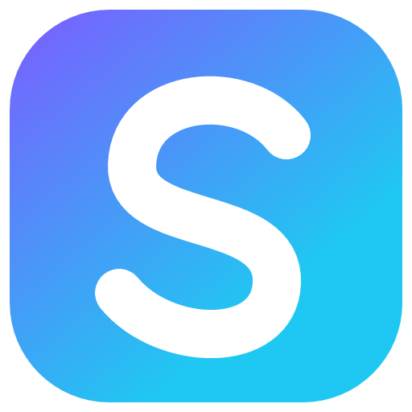
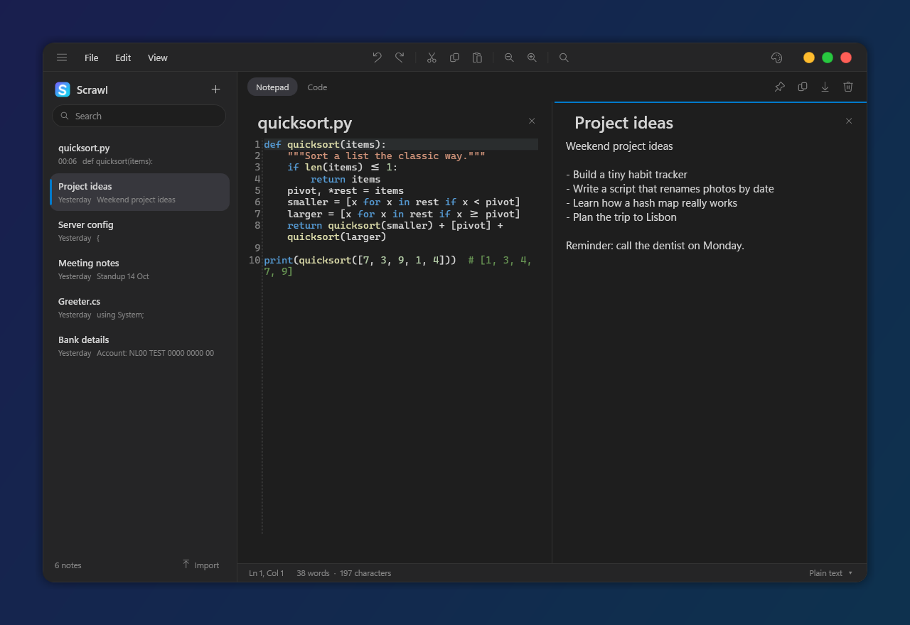
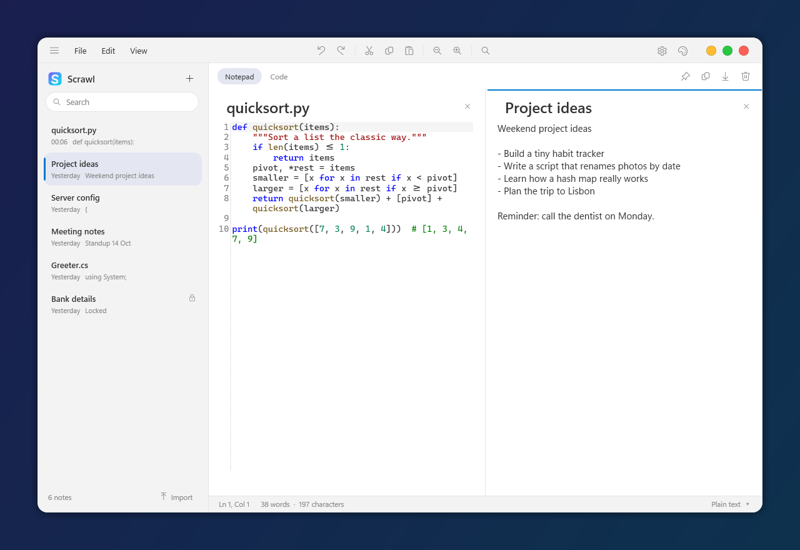
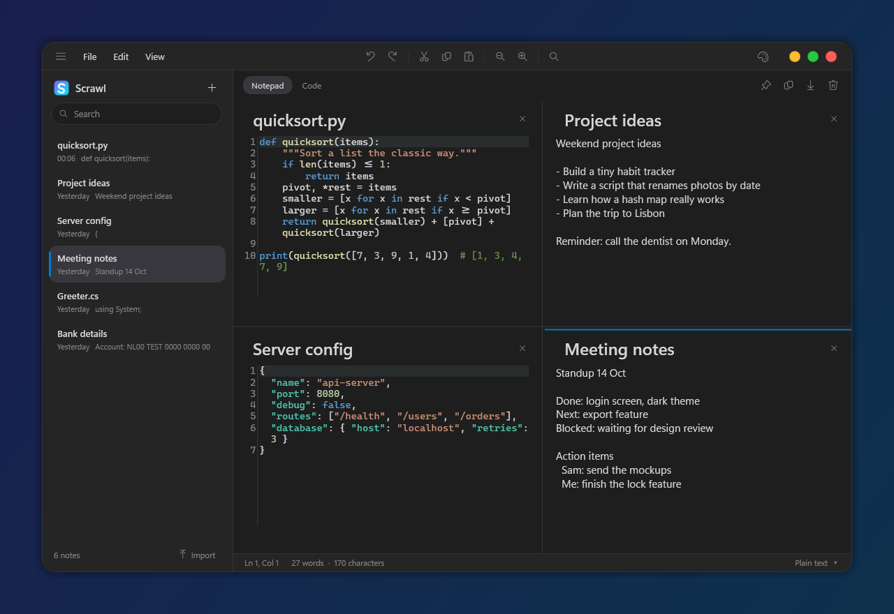
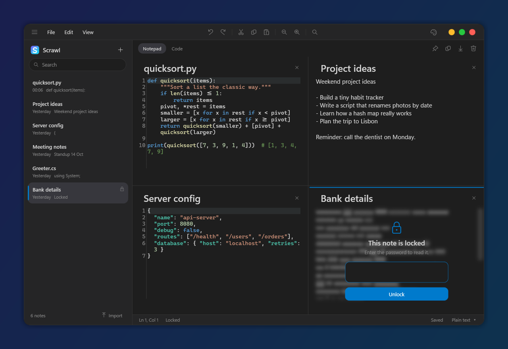
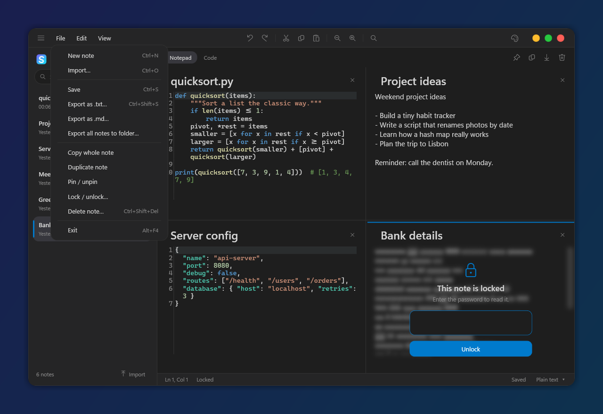

<div align="center">



# Scrawl

**A notepad when you want one, a code editor when you need one.**<br>
Plain notes, code with VS Code colors, and up to four notes side by side.




</div>

## Why

Most notes apps are either too plain or too heavy. Scrawl keeps two kinds of notes in one small window: **Notepad** notes that behave exactly like a classic notepad, and **Code** notes with syntax colors, line numbers and auto-indent. Open several at once, lock the private ones with a password, and everything stays on your device.

It is a single ~1 MB executable. No installer, no account, no telemetry, no network access.

## Features

- **Notepad notes**: plain text only. No colors, no line highlight, no auto-indent. Enter works like a classic notepad
- **Code notes**: syntax colors for C#, JavaScript, TypeScript, Python, Java, C/C++, Go, Rust, JSON, HTML/XML, CSS, SQL and shell. Paste code into a notepad note and the language is detected for you
- **Up to four notes side by side**: drag a note from the list onto the editor and drop it on a tile. Drag the dividers to resize
- **Password locked notes**: encrypted on disk (AES-256-GCM) and blurred until you enter the password. Deleting a locked note asks for it too
- **One-click download**: saves the note as `.txt` in your Downloads folder. Hover the button to export with any extension you type
- **17 themes**: Dark+, Light+, Monokai, Dracula, Nord, Solarized (dark and light), Tokyo Night, One Dark, GitHub (dark and light), Catppuccin Mocha, Gruvbox (dark and light), Rosé Pine, Midnight and Paper
- **Right-click menu** on notes: open, open side by side, pin, rename, duplicate, copy, download, lock, delete
- **File, Edit and View menus** with text tools: sort lines, remove duplicates, change case, insert date, duplicate or delete a line, zoom
- **Settings**: theme, font size, word wrap, line numbers, what new notes start as, desktop shortcut and text file handling
- **Opens text files**: set Scrawl up for `.txt` in Settings and a double-click opens the file as a note. Only one Scrawl runs at a time
- Rounded window with macOS style buttons, a notes list that slides away (`Ctrl+B`), search, pinning, automatic saving
- Import and export `.txt`, `.md` and code files, or export every note to a folder at once

## Screenshots

<table>
  <tr>
    <td></td>
    <td></td>
  </tr>
  <tr>
    <td align="center">Dark+</td>
    <td align="center">Light+</td>
  </tr>
  <tr>
    <td></td>
    <td></td>
  </tr>
  <tr>
    <td align="center">Four notes at once</td>
    <td align="center">Password locked note</td>
  </tr>
  <tr>
    <td></td>
    <td></td>
  </tr>
  <tr>
    <td align="center">File menu</td>
    <td align="center">Settings</td>
  </tr>
</table>

## Install

1. Download `Scrawl.exe` from the [latest release](../../releases/latest) (about 1 MB).
2. Put it anywhere and start it.
3. On the first start Scrawl asks whether to create a desktop shortcut and whether to use it for text files.

`Scrawl.exe` needs the [.NET 8 Desktop Runtime](https://dotnet.microsoft.com/download/dotnet/8.0/runtime). If it is missing, Windows shows a link to install it. Prefer not to install anything? Download `Scrawl-standalone.exe` instead: the same app with the runtime included (about 70 MB).

> Windows SmartScreen may warn about an unsigned app the first time. Choose "More info", then "Run anyway". The source is in this repository if you prefer to build it yourself (see [Build](#build)).

Requires Windows 10 or 11.

## Using it

| Do this | To get this |
| --- | --- |
| Click a note | Open it in the active pane |
| Drag a note onto the editor | Open it side by side (up to four) |
| Right-click a note | The note menu, without opening it |
| Hover the download button | Export with any extension |
| Click the gear | Settings |
| `Notepad` / `Code` above the editor | Switch what kind of note it is |

### Keyboard

| Key | Action |
| --- | --- |
| `Ctrl+N` | New note |
| `Ctrl+O` | Import files |
| `Ctrl+S` | Save now |
| `Ctrl+Shift+S` | Export as `.txt` (choose a location) |
| `Ctrl+F` | Search notes |
| `Ctrl+B` or `Ctrl+\` | Show or hide the notes list |
| `Ctrl+W` | Close the active pane |
| `Ctrl+,` | Settings |
| `Ctrl+D` | Duplicate line (code notes) |
| `Ctrl+Shift+K` | Delete line |
| `F5` | Insert date and time |
| `Ctrl++`, `Ctrl+-`, `Ctrl+0`, `Ctrl+wheel` | Zoom |
| `Ctrl+Shift+Del` | Delete note |

## Your data

Notes are saved as you type, and every write goes through a temporary file first, so a crash cannot leave a half-written file. They live in `%LOCALAPPDATA%\Scrawl\notes.json` next to `settings.json`. Set the `SCRAWL_DATA_DIR` environment variable to use another folder.

**Locked notes** are stored encrypted with AES-256-GCM, using a key derived from your password (PBKDF2, 200,000 rounds). Their text is never written to disk in plain form. If you forget a password the note cannot be recovered. Titles are not encrypted, only the text.

## Build

Requires the [.NET 8 SDK](https://dotnet.microsoft.com/download/dotnet/8.0) on Windows.

```powershell
dotnet run --project Scrawl.csproj                       # run
dotnet run --project tests/Scrawl.SmokeTests.csproj      # smoke checks
```

Build the small `Scrawl.exe` (needs the .NET 8 Desktop Runtime to run):

```powershell
dotnet publish Scrawl.csproj -c Release -r win-x64 -p:SelfContained=false -p:PublishSingleFile=true -p:PublishReadyToRun=false -o publish
```

For the standalone build with the runtime included, use `-p:SelfContained=true -p:IncludeNativeLibrariesForSelfExtract=true -p:EnableCompressionInSingleFile=true` instead.

Pushing a tag like `v1.0.1` builds both on GitHub and attaches them to a release.

The only dependency is the [AvalonEdit](https://github.com/icsharpcode/AvalonEdit) editor control.

| Path | What is in it |
| --- | --- |
| `MainWindow.xaml(.cs)` | Window, menus, panes, drag and drop, settings |
| `Controls/NotePane.xaml(.cs)` | One note on screen: title, editor and lock screen |
| `Models/Note.cs` | Note data and change notifications |
| `Services/NoteStore.cs` | Local JSON storage |
| `Services/NoteLock.cs` | Password protection (AES-GCM, PBKDF2) |
| `Services/CodeHighlighter.cs` | Tokenizer and language detection |
| `Services/CodeColorizer.cs` | Editor coloring and notepad indentation |
| `Services/Themes.cs` | Theme colors |
| `Services/Settings.cs` | Remembered preferences |
| `Services/SystemIntegration.cs` | Desktop shortcut and "open text files with Scrawl" |
| `tests/` | Smoke checks for storage, highlighting, panes and encryption |

## Contributing

Issues and pull requests are welcome. Please keep the app small and fast, and keep the interface, code and docs in English.

## License

[MIT](LICENSE)
