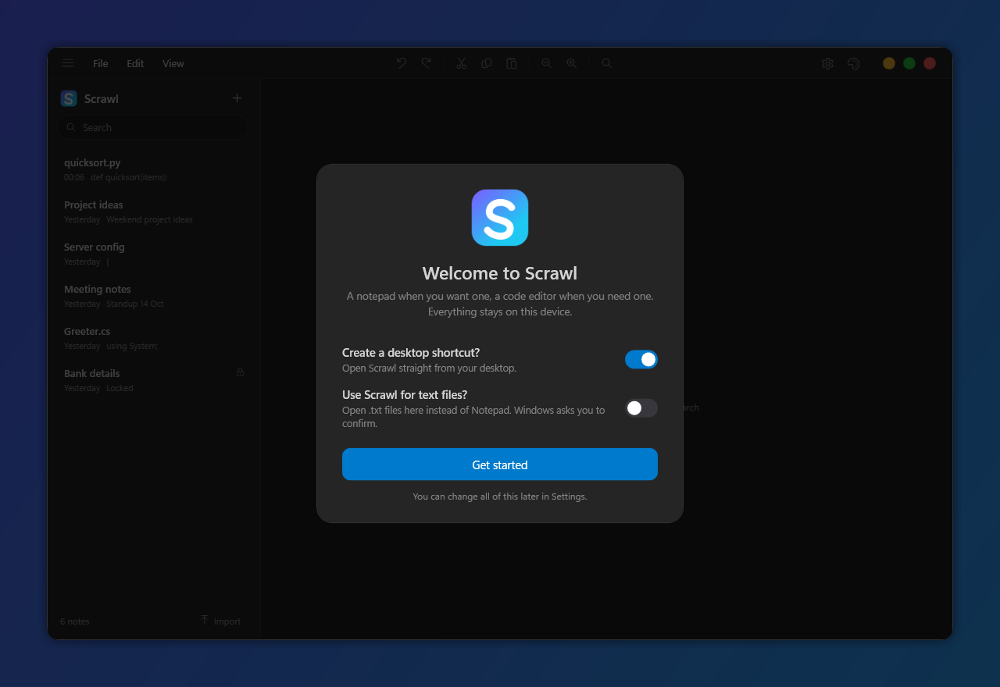
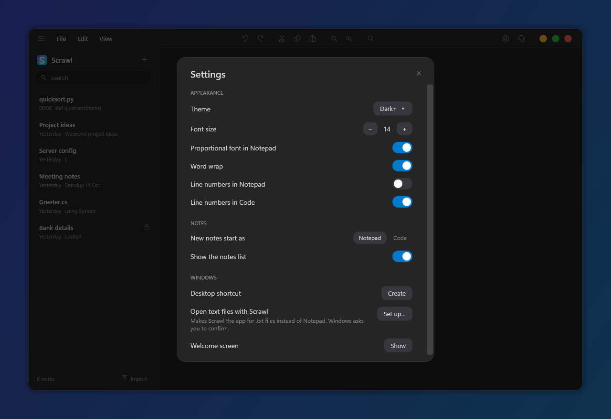

<p align="center">
  
</p>

<h1 align="center">Scrawl</h1>

<p align="center">
  A small, fast notes app for Windows. A plain notepad when you want one, a code editor with VS Code colors when you need that.<br>
  Your notes stay on your device.
</p>

<p align="center">
  
</p>

## Download

Grab `Scrawl.exe` from the [latest release](../../releases/latest) and run it. It is a single file and needs nothing installed. On the first start Scrawl asks whether to create a desktop shortcut and whether to use it for text files.

> Windows SmartScreen may warn about an unknown publisher because the app is not code-signed. Choose **More info**, then **Run anyway**.

## Features

- **Notepad notes**: plain text only. No colors, no line highlight, no auto-indent. Enter works like a classic notepad.
- **Code notes**: syntax colors, line numbers and auto-indent for C#, JavaScript, TypeScript, Python, Java, C/C++, Go, Rust, JSON, HTML/XML, CSS, SQL and shell. Paste code into a notepad note and the language is detected automatically.
- **Up to four notes side by side**: drag a note from the list onto the editor and drop it on a tile. Drag the dividers to resize panes in any direction.
- **Password locked notes**: right-click a note and lock it. The text is encrypted on disk (AES-256-GCM, PBKDF2 key) and shows blurred until you enter the password. Deleting a locked note asks for the password too.
- **Download in one click**: the download button saves the note as `.txt` in your Downloads folder. Hover it to export with any extension you type.
- **17 themes**: Dark+, Light+, Monokai, Dracula, Nord, Solarized (dark and light), Tokyo Night, One Dark, GitHub (dark and light), Catppuccin Mocha, Gruvbox (dark and light), Rosé Pine, Midnight and Paper.
- **Clean, rounded window** with macOS style window buttons, and a notes list that slides in and out (`Ctrl+B`).
- **Right-click menu** on notes: open, open side by side, pin, rename, duplicate, copy, download, lock and delete.
- File, Edit and View menus with many text tools: sort lines, remove duplicates, change case, insert date, duplicate or delete a line, zoom and more.
- **Settings** (gear icon or `Ctrl+,`): theme, font size, word wrap, line numbers, what new notes start as, desktop shortcut and text file handling.
- **Opens text files**: set Scrawl up for `.txt` files in Settings and double-clicking a text file opens it as a note. Only one Scrawl runs at a time.
- Search, pinning, automatic saving, and import or export of `.txt`, `.md` and code files (or all notes to a folder).
- No account, no network, no browser runtime. The only dependency is the [AvalonEdit](https://github.com/icsharpcode/AvalonEdit) editor control.

<p align="center">
  
</p>

<p align="center">
  
  
</p>

<p align="center">
  
  
</p>

## Requirements

- Windows 10 or 11
- To run from source: the .NET 8 SDK (the released `Scrawl.exe` needs nothing)

## Run from source

1. Install the .NET 8 SDK (or newer).
2. Clone this repository and open its folder in a terminal.
3. Run the app:

   ```powershell
   dotnet run --project Scrawl.csproj
   ```

   On Windows you can also double-click `start.bat`.

To build the single-file `Scrawl.exe` yourself:

```powershell
dotnet publish Scrawl.csproj -c Release -r win-x64 --self-contained true -p:PublishSingleFile=true -p:IncludeNativeLibrariesForSelfExtract=true -p:EnableCompressionInSingleFile=true -o publish
```

Pushing a tag like `v1.0.0` builds this automatically and attaches it to a GitHub release.

Run the smoke checks (storage, highlighting, panes, encryption) with:

```powershell
dotnet run --project tests/Scrawl.SmokeTests.csproj
```

## Keyboard shortcuts

| Shortcut | Action |
| --- | --- |
| `Ctrl+N` | New note |
| `Ctrl+O` | Import files |
| `Ctrl+,` | Settings |
| `Ctrl+S` | Save now |
| `Ctrl+Shift+S` | Export as `.txt` (choose a location) |
| `Ctrl+F` | Search notes |
| `Ctrl+B` or `Ctrl+\` | Show or hide the notes list |
| `Ctrl+W` | Close the active pane |
| `Ctrl+D` | Duplicate line (code notes) |
| `Ctrl+Shift+K` | Delete line |
| `F5` | Insert date and time |
| `Ctrl++`, `Ctrl+-`, `Ctrl+0`, `Ctrl+wheel` | Zoom |
| `Ctrl+Shift+Del` | Delete note |

## Storage and privacy

Notes are stored locally at `%LOCALAPPDATA%\Scrawl\notes.json` and settings in `settings.json` next to it. Set the `SCRAWL_DATA_DIR` environment variable to use another folder.

Locked notes are stored encrypted. If you forget a password the note cannot be recovered. Titles are not encrypted, only the text.

## Project structure

```text
Scrawl/
├── Assets/                           # Logo and app icon
├── Controls/NotePane.xaml(.cs)       # One note on screen: title + editor + lock screen
├── Models/Note.cs                    # Note data and change notifications
├── Services/NoteStore.cs             # Local JSON storage
├── Services/NoteLock.cs              # Password protection (AES-GCM, PBKDF2)
├── Services/Settings.cs              # Remembered preferences
├── Services/SystemIntegration.cs     # Desktop shortcut, "open text files with Scrawl"
├── Services/Themes.cs                # Theme colors
├── Services/CodeHighlighter.cs       # Tokenizer and language detection
├── Services/CodeColorizer.cs         # Editor coloring, notepad indentation
├── docs/screenshots/                 # README images
├── tests/Program.cs                  # Smoke checks
├── App.xaml                          # Shared control styles
└── MainWindow.xaml(.cs)              # Window, menus, panes, drag and drop
```

## License

MIT. See [LICENSE](LICENSE).
